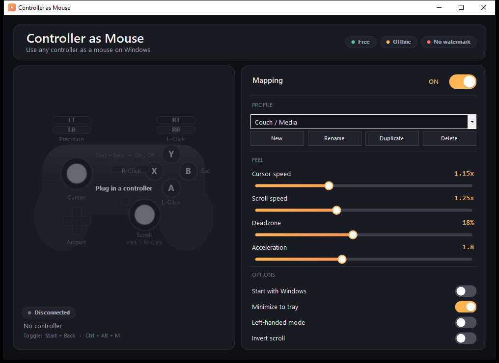

# Controller as Mouse

**Use any controller as a mouse on Windows — free and fully offline.**

Plug in an **Xbox**, **DualShock 4**, or **DualSense** pad and it *is* your mouse —
everywhere on the desktop. Move the cursor, click, scroll, and drag from the couch
with a game controller. Controller as Mouse turns a **gamepad into a mouse** on
Windows 10 and 11: no account, no ads, no watermark, nothing to configure in a text
file.

> A friendly, GUI-first, **free open-source alternative to Gopher360** and other
> controller-to-mouse tools — sliders and profiles instead of hand-edited `.ini`
> files. If you searched for how to **use a controller as a mouse**, **control the
> mouse with a controller**, or **controller to mouse software**, this is it.

> **Not affiliated with or endorsed by Gopher360 or Tylemagne.** Independent,
> clean-room implementation released under the MIT license.

---

## Who it's for

Controller as Mouse is built for the **living room, HTPC / media center,
presentations, and accessibility** — driving Windows one-handed, or with limited
fine-motor control, using a comfortable game pad instead of a mouse. It is a
general desktop tool, **not** a gaming aim tool.

## Features

**Core**
- Left stick → smooth cursor with an **acceleration curve** (fine near center, fast at the edge — not linear)
- Right stick → **scroll** (vertical *and* horizontal)
- **A** / **RT** → left click · **X** → right click · **R3** (right-stick press) → middle click
- **D-pad** → arrow keys · **B** → Esc
- **LT** → precision: the harder you pull, the finer the cursor moves
- **Start + Back** → toggle the whole mapping on/off
- Works across the **entire desktop** — browsers, media players, any window

**What makes it nicer than the classics**
- Sensitivity by **sliders in the UI** — Cursor speed, Scroll speed, Deadzone, Acceleration, scroll inversion — never a text file
- **Profiles** saved as JSON in `%LOCALAPPDATA%\ControllerAsMouse\`, with presets *Couch / Media*, *Precision*, *Left-handed*, plus New / Rename / Duplicate / Delete
- **Start with Windows** (per-user, no admin), launches minimized to the tray
- **Tray icon** with a right-click menu (Enable/Disable, pick a profile, Settings, Quit)
- **Hot-plug**: connect or unplug a pad and it's picked up instantly, no restart
- **Global toggle** from the pad (Start + Back) *and* the keyboard (Ctrl + Alt + M)
- **Left-handed mode** swaps the sticks for one-handed use
- **Xbox / DualShock 4 / DualSense** supported out of the box via SDL2 — no vendor drivers

## Default mapping

| Control | Action |
|---|---|
| Left stick | Move cursor (acceleration curve) |
| Right stick | Scroll (vertical + horizontal) |
| A | Left click (hold to drag) |
| RT | Left click |
| X | Right click |
| R3 (right-stick click) | Middle click |
| LT (analog) | Precision — slows the cursor proportionally |
| D-pad | Arrow keys |
| B | Esc |
| Start + Back | Toggle mapping on/off |

## Install & use

1. Download `ControllerAsMouse.zip` from the [Releases](../../releases) page.
2. Extract the archive and run `ControllerAsMouse.msi` — the installer is small and finishes in a couple of seconds.
3. Plug in a controller. The status line shows e.g. *Controller connected:
   DualSense*. Move the left stick — that's your cursor.
4. Optionally tick **Start with Windows** and **Minimize to tray**.

A small `.msi` installer, no runtime prerequisites, no internet. The `.msi` is unsigned, so on
first launch Windows SmartScreen may warn — click **More info → Run anyway**.

## Supported controllers

Works with **Xbox controllers** (use your Xbox controller as a mouse), **PlayStation
DualShock 4** and **DualSense** (PS4 / PS5 controller as a mouse), and most
XInput / DirectInput gamepads, via SDL2's read-only game-controller API — no vendor
drivers needed.

## How it works

Controller as Mouse **moves the mouse** — it does not create a virtual controller
and installs no kernel driver. Input is synthesized with the standard Win32
`SendInput` API; controllers are read with SDL2's read-only `SDL_GameController` API.
That keeps it a plain, transparent desktop utility.

## How it's built

- **C# / .NET 8** WinForms (`net8.0-windows`, `win-x64`)
- **SDL2** for cross-vendor controller input (`SDL_GameController`) via a small hand-written P/Invoke binding
- **Win32 `SendInput`** (P/Invoke to `user32`) for mouse/keyboard synthesis
- The SDL2 native DLL is embedded and extracted to `%LOCALAPPDATA%` on first run, so the shipped product is a `.msi` installer

## License

MIT — see [LICENSE](LICENSE). Bundled third-party components and their licenses are
listed in `THIRD_PARTY_NOTICES.txt` (SDL2 is zlib-licensed).

*Not affiliated with or endorsed by Gopher360 or Tylemagne. All trademarks belong to
their respective owners.*
